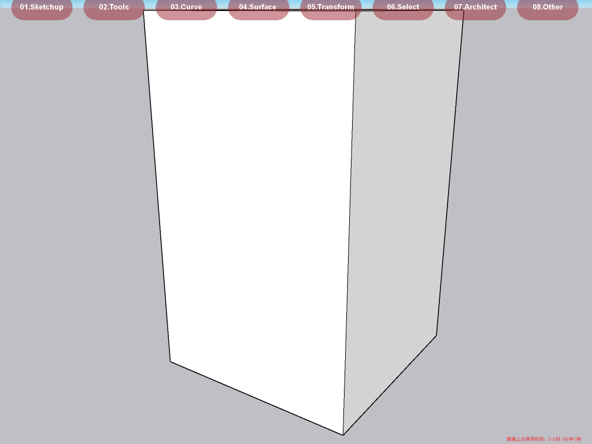

# dsh-su — SketchUp bridge for DeepSeek Harness


A **DeepSeek Harness (DSH) plugin** that turns a live SketchUp Pro session into agent
tools: run Ruby task scripts, inspect the model, save `.skp` files and capture viewport
images — all over a local JSON-lines TCP bridge, with the companion SketchUp extension
installed and updated automatically.

一个把 **SketchUp 2023** 接入 **DeepSeek Harness** 的插件：DSH Agent 可以直接驱动一个
常驻的 SketchUp 会话（跑 Ruby 脚本、查模型、存 `.skp`、截图），配套的 SketchUp 扩展由插件
自动安装/更新。



## Features

- **8 agent tools** — `su_status`, `su_install_extension`, `su_ensure`, `su_run`,
  `su_eval`, `su_save`, `su_capture`, `su_stop`.
- **Warm SketchUp session** — launch once, then every task is a short bridge round-trip
  (typically 10–100 ms) instead of restarting the app.
- **Self-contained SketchUp extension** — installed into `Plugins\` on first use
  (also shipped as a `.rbz`); starts the bridge automatically and adds
  *Extensions → DSH Bridge* (status / logs / restart).
- **Bundled metric modelling kit** — task scripts `require 'su_kit'` for boxes,
  cylinders, extrusions, tags, materials, cameras, screenshots and validation helpers
  (metres in, metres out).
- **Bundled skill** `sketchup-modeling` — workflow + SketchUp 2023 / Ruby 2.7 pitfalls.
- **Safe by default** — tools are workspace-restricted, refuse silent overwrites, and
  refuse to reset a document when another bridge is already running.

## Architecture

```
DSH plugin (this package)                     SketchUp 2023 extension (bundled)
┌──────────────────────────────┐  TCP 47311   ┌────────────────────────────────────┐
│ index.js  (8 tools)          │  JSON lines  │ dsh_su_bridge.rb  (extension loader)│
│ lib/su-bridge.js             │ ───────────▶ │   └─ dsh_su_bridge/server.rb        │
│ lib/sketchup-extension.js    │ ◀─────────── │        (TCP server on main thread)  │
└──────────────────────────────┘   ok/result  │   └─ dsh_su_bridge/su_kit.rb        │
        │ installs extension ─────────────────┐ └────────────────────────────────────┘
        │ %APPDATA%\SketchUp\SketchUp 2023\   │
        │        SketchUp\Plugins\            │  bridge data/logs:
        └─────────────────────────────────────┘  %LOCALAPPDATA%\dsh-su\
```

SketchUp's Ruby API is single-threaded: the socket thread only does I/O, and model
commands are queued through `UI.start_timer` onto the main thread. The extension also
handles SketchUp 2023's quirk that Ruby plugins are **not** loaded while the welcome
screen is open — the plugin therefore launches SketchUp **with a template `.skp`**.

## Requirements

- Windows 10/11
- SketchUp Pro **2023** (developed and tested with 23.1.315, Ruby 2.7.7)
- DeepSeek Harness with a desktop profile (`~/.dsh/profiles/desktop`)
- Node.js ≥ 22.12 (provided by DSH)

## Install

### 1. Add the DSH plugin

```powershell
$profile = "$env:USERPROFILE\.dsh\profiles\desktop"

# In $profile/package.json:
#   dependencies += "dsh-su": "link:D:/path/to/dsh-su"      (link: = live link, recommended)
#                    or      "dsh-su": "file:D:/path/to/dsh-su"
#   dsh.profile.bundles += "dsh-su"

# Install with the Node/pnpm bundled with DSH:
$node = "$env:USERPROFILE\.dsh\dsh-runtimes\dsh-primary-runtime\dependencies\node\bin\node.exe"
$pnpm = "$env:USERPROFILE\.dsh\dsh-runtimes\dsh-primary-runtime\dependencies\pnpm\bin\pnpm.mjs"
Set-Location $profile
& $node $pnpm install --prefer-offline
```

Restart DeepSeek Harness. The tools listed above appear in the tool set and the
`sketchup-modeling` skill is registered.

### 2. SketchUp side (automatic)

Nothing to do: `su_ensure` / `su_install_extension` copy the bundled extension into
`%APPDATA%\SketchUp\SketchUp 2023\SketchUp\Plugins\` and update it when the version
changes. A SketchUp instance that is already open must be restarted once so the
extension loads.

Manual alternative: install `dist/dsh-su-sketchup-<version>.rbz` through
*Extension Manager*. Build it with `python scripts/build-artifacts.py`.

## Configuration

Configured through the plugin's `cordis.patch.yml` or your profile `cordis.patch.yml`:

```yaml
- id: su-modeling
  name: dsh-su
  config:
    sketchupExecutable: 'C:\Program Files\SketchUp\SketchUp 2023\SketchUp.exe'  # optional
    templatePath: 'C:\Program Files\SketchUp\SketchUp 2023\Resources\en-US\Templates\Temp01a - Simple.skp'  # optional
    pluginsDirectory: ''        # default: %APPDATA%\SketchUp\SketchUp 2023\SketchUp\Plugins
    host: '127.0.0.1'
    port: 47311
    timeoutMs: 180000           # per bridge command
    launchTimeoutMs: 240000     # wait for the bridge after launching SketchUp
    maxOutputChars: 20000
    restrictToWorkspace: true   # su_run/su_save/su_capture stay inside the session workspace
    autoInstallExtension: true
    registerSkill: true
```

`sketchupExecutable` and `templatePath` are optional: the plugin probes common install
locations (`Program Files`, `D:\su`, `SU_EXE` / `SU_TEMPLATE` environment variables)
and reports what it found in `su_status`.

## Tools

| tool | what it does |
| --- | --- |
| `su_status` | bridge health, active model, extension version, detected paths, hints |
| `su_install_extension` | copy/update the SketchUp extension in `Plugins\` |
| `su_ensure` | install extension, reuse or launch SketchUp, wait for the port, set units to metres |
| `su_run` | run a `.rb` task script inside SketchUp; returns `$dsh_result` |
| `su_eval` | evaluate a Ruby snippet; returns `$dsh_result` |
| `su_save` | save the document as `.skp` (workspace-restricted, no silent overwrite) |
| `su_capture` | write a viewport PNG (workspace-restricted, no silent overwrite) |
| `su_stop` | quit the SketchUp instance that owns the bridge |

Typical flow:

```
su_status
su_ensure
su_run(script: "tasks/build_model.rb", args: { out: "deliver/model.skp" })
su_capture(output_path: "qa/hero.png", width: 1600, height: 1100)
# read_image("qa/hero.png") to actually inspect the result
su_save(output_path: "deliver/model.skp")
```

Task scripts run inside SketchUp (Ruby 2.7) and can use the bundled kit:

```ruby
require 'su_kit'

k = SuKit::Kit.new
k.reset                        # empty model, metres
k.tag('01-SOLID', 'C8BFA8')
k.box([0, 0, 0], 1.2, 1.2, 2.0, tag: '01-SOLID')
k.material('MAT-A', 'C8BFA8')
k.camera([3, -3, 2], [0.6, 0.6, 1.0], lens: 50)
k.zoom_extents
k.capture('preview.png', 1600, 1000)
$dsh_result = { 'counts' => k.counts, 'bbox_m' => k.bbox_m, 'summary' => k.summary }
```

`su_kit` API: `reset units tag use_tag box cylinder polygon_extrude polyline arc_2d
group erase_all smooth_curves material paint camera zoom_extents dolly_out capture
bbox_m counts summary save export`, plus helpers `Chrono box_f seg_box_f cyl_f sphere_f
glass_f edge_hide! text3d white_studio! shadow_setup! frame_view! sanity_bounds!
deep_counts`.

## Protocol

One JSON object per line over TCP (`127.0.0.1:47311`):

```json
{"id":"a1","cmd":"run","script":"C:/abs/task.rb","args":{}}
{"id":"a1","ok":true,"result":{"script":"...","elapsed_ms":53.4,"result":{}}}
{"id":"a2","ok":false,"error":"RuntimeError: ...","backtrace":[]}
```

Commands: `ping info setup reset run eval save capture open new reload quit`.
The extension log lives in `%LOCALAPPDATA%\dsh-su\logs\bridge.log`; `ready.json` holds
the active port and SketchUp/Ruby versions.

## Tests

```powershell
# no SketchUp needed: module shape, tool/skill registration, path guards
node test/unit.mjs

# real SketchUp: extension install, launch, run, save, capture, quit
node test/integration.mjs

# the same but through the actual plugin tools (needs SketchUp)
node test/tools-e2e.mjs
```

`test/integration.mjs` and `test/tools-e2e.mjs` refuse to run while another bridge is
answering, so they never touch a document you have open; they launch and quit their own
SketchUp instance. Set `SU_EXE` / `SU_TEMPLATE` / `SU_PORT` to override detection.

## Build artifacts

```powershell
python scripts/build-artifacts.py
# dist/dsh-su-sketchup-<version>.rbz   SketchUp extension (Extension Manager)
# dist/dsh-su-<version>.zip            DSH plugin package
```

`scripts/build-artifacts.py` packages the extension into `.rbz` and the plugin into a
zip. The extension Ruby files are committed, so building is optional.

## Repository layout

```
dsh-su/
  index.js                     DSH plugin entry (tools + skill registration)
  cordis.patch.yml             bundle registration
  lib/su-bridge.js             TCP JSON-lines client
  lib/sketchup-extension.js    extension install, path detection, launch/wait
  sketchup/dsh_su_bridge.rb    SketchUp extension loader
  sketchup/dsh_su_bridge/      main.rb / server.rb / su_kit.rb / VERSION
  skills/sketchup-modeling/    bundled agent skill
  scripts/                     build helpers
  test/                        unit + integration + end-to-end tests
```

## Uninstall

1. DSH: remove `dsh-su` from the profile `dependencies` and `dsh.profile.bundles`,
   run `pnpm install`, restart DSH.
2. SketchUp: uninstall *DSH Bridge (SU + DSH)* in Extension Manager, or delete
   `Plugins\dsh_su_bridge.rb` and `Plugins\dsh_su_bridge\`.
3. Optional: delete `%LOCALAPPDATA%\dsh-su\`.

## Limitations

- One bridge per machine: a single SketchUp instance owns port `47311`; other instances
  need a restart to take over. `su_ensure` reports when it started a new instance.
- Only SketchUp 2023 is tested (Ruby 2.7). Newer SketchUp versions should mostly work
  but are unverified.
- The bridge is local-only (`127.0.0.1`) and has no authentication: treat it as a
  development tool run by the same user.

## License

MIT — see [LICENSE](LICENSE).
